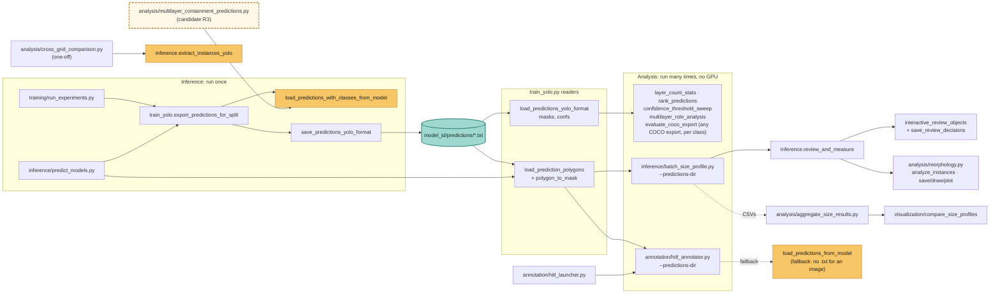
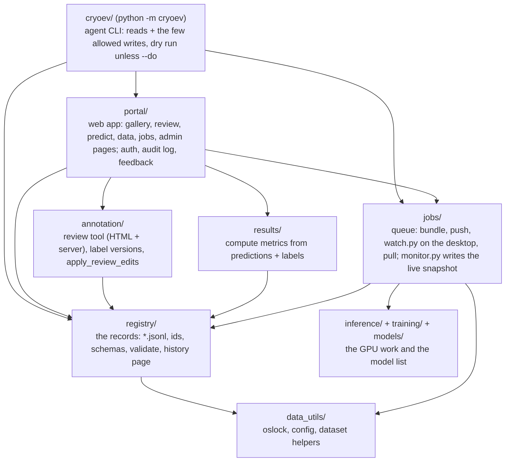

# Architecture: how the pieces connect

The core rule is **run inference once, analyze many times.** Models are loaded in one place, which writes prediction files. Everything downstream reads those files, so it needs no GPU or weights.

**Key:** amber = loads a model and runs inference · teal = prediction files · dashed outline = still runs live inference and is a cleanup candidate (see [`CLEANUP_CANDIDATES.md`](../CLEANUP_CANDIDATES.md)).

## Separate workflow
`embedding/` (DINO embeddings + clustering) is independent of this graph. It shares only `data_utils.prepare_all_layer_singleclass` (category map), the geometry in `analysis/multilayer_containment.py` (`classify_roles()`, `find_containment()` and its own `polygon_to_mask()`), and `training.monitor_run.get_gpu_info`. See `embedding/README.md`.

## History
The pre-cleanup layout (U-Net stack, live inference in profiling and annotation, package `__init__` side effects) is preserved at git tag `pre-cleanup`.

## Platform layers (round 10)

The inference graph above is one slice. The rest of the repo is a laptop-owned platform that records what exists, runs work on the lab GPU desktop, and shows it to people. Data flows down this stack; each layer reads the one below and writes only its own files.

| Layer | What it is | Writes | Docs |
|---|---|---|---|
| `registry/` | The source of truth: one JSONL per entity (image, label_version, dataset, job, ...), id rules, schema checks, `validate.py` (read-only scan of the laptop tree), the history page. Writers stamp `created_by` / `created_via` from `--who` / `$CRYOEV_FOR` / `$CRYOEV_VIA` (`registry/actor.py`). | `<laptop>/registry/*.jsonl` | [`TRACKING_CONTRACT.md`](TRACKING_CONTRACT.md) |
| `jobs/` | Laptop to desktop queue over an SMB share: `registry.py job new`, bundle, `watch.py` (desktop, never writes the registry), importer, `predict_set.py` / `predict_local.py`, `monitor.py` (rewrites `registry/live/live.json` about every 30 s). | the share, `registry/live/`, job records | [`JOBS.md`](JOBS.md) |
| `annotation/` | The review tool and its servers (single and multi-package), label versions, `apply_review_edits.py`. | label versions, review edits | [`REVIEW_TOOL.md`](REVIEW_TOOL.md) |
| `results/` | `python -m results`: metrics computed from predictions and labels. | result files | |
| `portal/` | The web app for collaborators: modules per page, access control, the audit log (`portal/audit.py`), feedback, uploads, the predict flow. Calls the layers above; never edits records directly. | `~/.cryoev/portal*` state, audit log | `portal/README.md` |
| `cryoev/` | The agent CLI: `status`, `find`, `show`, `lineage`, `pull`, `register`, `predict new`, `feedback`. Thin wrappers over the layers above; each `--do` is logged to `<laptop>/logs/agent_actions.jsonl`. | the action log, plus what the wrapped tool writes | [`AGENTS.md`](AGENTS.md) |

**Importing the registry (round 11).** `registry/` is a package (an empty `__init__.py`). Code and tests import it one way: `from registry import store` (the records API: `current`, `history`, `append`, `set_status`, `new_job`; often `as registry` or `as R`), or the module they need (`importers`, `validate`, `history_page`, `ids`, `schema_check`). So a process holds one module object per file, and a test that patches `store.LOCK_WAIT` patches what the code uses.
- Never put `registry/` on `sys.path` and never load a registry file by path. With `registry/` on the path, `import registry` finds `registry/registry.py` (the script shim) instead of the package. `tests/test_registry_package.py` fails on either, and on a bare `import importers`.
- `python registry/registry.py <command>` still works (callers and docs keep this path): the shim runs `store.main()`. Every registry script with a `__main__` block starts by dropping its own folder from `sys.path` and adding the repo root, so running any of them by path is safe.
- Data-root helpers (`config`, `oslock`, `path_guard`, `actor`) live in `data_utils/`; `registry/actor.py` is only a re-export kept for old callers.

**Tests follow the same shape.** Each layer has a `tests/` suite (`registry`, `jobs`, `annotation`, `results`, `portal`, `cryoev`, `tools`, `data_utils`, plus the repo-wide `tests/`). `tools/test_gate.py` runs them per file, in parallel, and knows which suites a change affects (see [`TOOLS.md`](TOOLS.md)). Tests use temp roots only and never write the live data tree.
